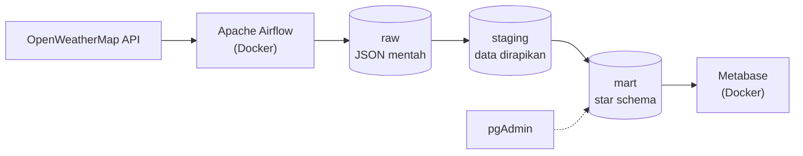
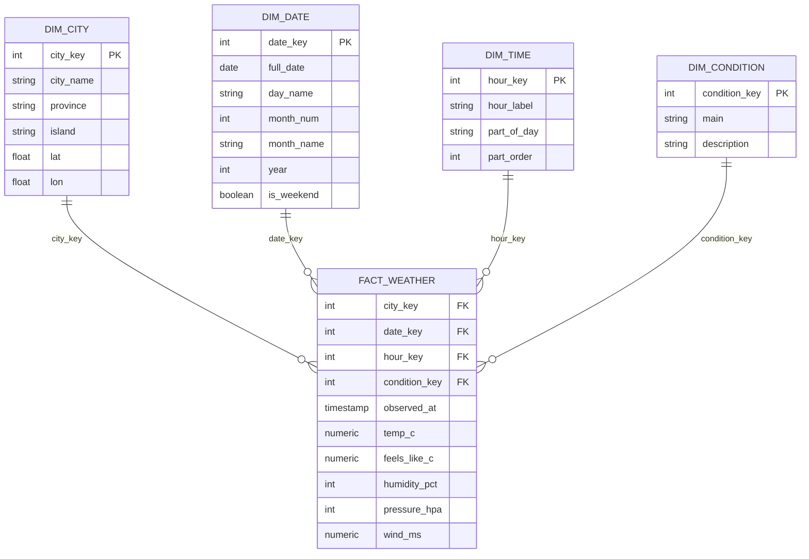
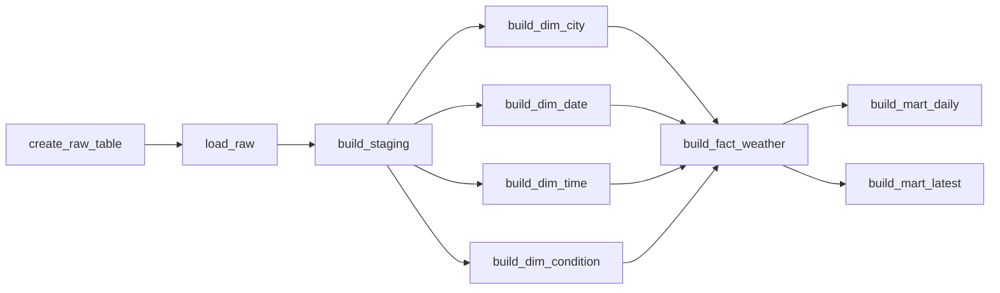

# Weather Data Pipeline

Pipeline data end-to-end yang mengambil cuaca terkini empat kota di Indonesia dari API OpenWeatherMap setiap jam, menyimpannya ke PostgreSQL dengan model star schema, lalu menampilkannya di dashboard Metabase. Proses diatur oleh Apache Airflow.

## Arsitektur



PostgreSQL berjalan langsung di Windows (native). Airflow dan Metabase berjalan di Docker dan mengakses PostgreSQL lewat `host.docker.internal`.

## Teknologi

| Komponen | Fungsi |
|---|---|
| OpenWeatherMap API | Sumber data cuaca terkini (endpoint Current Weather) |
| Apache Airflow 3.3 (Docker Compose) | Penjadwal dan orkestrasi pipeline |
| PostgreSQL (native) | Data warehouse |
| pgAdmin | Mengelola dan memeriksa database |
| Metabase (Docker) | Dashboard dan visualisasi |

## Lapisan data

| Schema | Isi |
|---|---|
| `raw` | Respons API apa adanya (JSONB). Hanya bertambah, tidak dihapus |
| `staging` | Data yang sudah di-parse, tipe data benar, duplikat dibuang |
| `mart` | Star schema (dimensi dan fakta) dan tabel ringkasan untuk dashboard |

### Star schema



Grain tabel fakta: satu pengamatan cuaca untuk satu kota pada satu waktu pengukuran.

Tabel ringkasan untuk dashboard, dibangun dari fakta dan dimensi:

| Tabel | Isi |
|---|---|
| `mart.weather_latest` | Kondisi terbaru tiap kota |
| `mart.weather_daily` | Rangkuman harian per kota (rata-rata, minimum, maksimum, jumlah pengamatan) |

## Alur DAG

DAG `weather_pipeline` berjalan setiap jam (`@hourly`).



Tabel dimensi dibangun lebih dulu dan paralel, karena tabel fakta mencari kuncinya lewat join ke dimensi. Seluruh tabel `staging` dan `mart` dibangun ulang dari `raw` pada setiap run, sehingga aman dijalankan ulang.

## Struktur proyek

```
.
├── dags/
│   └── weather_pipeline.py
├── docker-compose.yaml
├── docs/
│   └── images/
└── README.md
```

## Dashboard

Dashboard Metabase berisi kartu berikut:

- Suhu rata-rata per kota
- Kondisi cuaca terbaru per kota
- Suhu rata-rata per jam per kota
- Suhu rata-rata per hari per kota

<!-- Setelah mengunggah screenshot ke docs/images/, hapus tanda komentar pada baris di bawah.


-->

## Cara menjalankan

### Prasyarat

- Windows dengan Docker Desktop (WSL2)
- PostgreSQL dan pgAdmin terpasang
- Akun dan API key dari [OpenWeatherMap](https://openweathermap.org) (key baru butuh sekitar 10 menit sampai 2 jam untuk aktif)

### 1. Siapkan PostgreSQL

Di pgAdmin (Query Tool, login sebagai `postgres`), ganti password sesuai keinginan:

```sql
CREATE USER etl_user WITH PASSWORD 'GANTI_PASSWORD_ETL';
CREATE USER bi_user  WITH PASSWORD 'GANTI_PASSWORD_BI';
```

Jalankan sendiri (satu perintah):

```sql
CREATE DATABASE warehouse;
```

Lalu buka Query Tool pada database `warehouse` dan jalankan:

```sql
CREATE SCHEMA raw;
CREATE SCHEMA staging;
CREATE SCHEMA mart;
GRANT USAGE, CREATE ON SCHEMA raw, staging, mart TO etl_user;
GRANT USAGE ON SCHEMA mart TO bi_user;
ALTER DEFAULT PRIVILEGES FOR ROLE etl_user IN SCHEMA mart
  GRANT SELECT ON TABLES TO bi_user;
```

### 2. Izinkan Docker mengakses PostgreSQL

1. Di `postgresql.conf`, set `listen_addresses = '*'`.
2. Di `pg_hba.conf`, tambahkan di baris paling bawah:
   ```
   host  warehouse  etl_user  172.16.0.0/12    scram-sha-256
   host  warehouse  bi_user   172.16.0.0/12    scram-sha-256
   host  warehouse  etl_user  192.168.0.0/16   scram-sha-256
   host  warehouse  bi_user   192.168.0.0/16   scram-sha-256
   ```
3. Restart service PostgreSQL lewat `services.msc`.
4. Buka port 5432 di firewall (PowerShell sebagai Administrator):
   ```powershell
   New-NetFirewallRule -DisplayName "PostgreSQL 5432" -Direction Inbound -Protocol TCP -LocalPort 5432 -Action Allow
   ```

### 3. Jalankan Airflow

Buat file `.env` di folder proyek (jangan diunggah ke Git):

```
AIRFLOW_UID=50000
FERNET_KEY=<kunci enkripsi buatan sendiri>
```

Membuat `FERNET_KEY`:

```powershell
docker run --rm apache/airflow:3.3.2 python -c "from cryptography.fernet import Fernet; print(Fernet.generate_key().decode())"
```

Jalankan:

```powershell
mkdir dags, logs, plugins, config
docker compose up airflow-init
docker compose up -d
```

Buka `http://localhost:8080` (login bawaan `airflow` / `airflow`, hanya untuk lokal; segera ganti).

### 4. Atur Variable dan Connection di Airflow

Admin → Variables → Add:

| Key | Value |
|---|---|
| `owm_api_key` | API key OpenWeatherMap |

Admin → Connections → Add:

| Field | Nilai |
|---|---|
| Connection ID | `warehouse_pg` |
| Type | Postgres |
| Host | `host.docker.internal` |
| Port | `5432` |
| Database | `warehouse` |
| Login | `etl_user` |
| Password | password `etl_user` |

Kredensial disimpan di Airflow, bukan di kode, sehingga tidak ikut terunggah ke repositori.

### 5. Jalankan DAG

Salin `weather_pipeline.py` ke folder `dags/`. Airflow membaca file baru dalam beberapa menit. Aktifkan DAG `weather_pipeline` lalu klik Trigger. Setelah semua task hijau, cek hasilnya di pgAdmin:

```sql
SELECT * FROM mart.weather_latest;
```

### 6. Sambungkan Metabase

Jalankan Metabase (contoh: `docker run -d -p 3000:3000 --name metabase metabase/metabase`), lalu buka `http://localhost:3000`.

Admin → Databases → Add database → PostgreSQL:

| Field | Nilai |
|---|---|
| Host | `host.docker.internal` |
| Port | `5432` |
| Database name | `warehouse` |
| Username | `bi_user` |

Batasi schema ke `mart`, lalu klik Sync database schema now. Di Admin → Table Metadata, atur `city_key`, `date_key`, `hour_key`, dan `condition_key` di tabel dimensi sebagai Entity Key, dan kolom kunci yang sama di `fact_weather` sebagai Foreign Key ke dimensi masing-masing. Dengan itu Metabase bisa menggabungkan tabel secara otomatis.

## Menambah kota

Edit daftar `CITIES` di `dags/weather_pipeline.py`. Setiap kota ditulis bersama provinsi dan pulaunya:

```python
CITIES = {
    "Jakarta": ("DKI Jakarta", "Jawa"),
    "Bandung": ("Jawa Barat", "Jawa"),
}
```

Uji nama kota dulu di browser (`.../data/2.5/weather?q=NAMA_KOTA&appid=KEY`). Satu nama kota yang tidak dikenal API membuat task `load_raw` gagal untuk semua kota.

## Keterbatasan

- API yang dipakai hanya memberi cuaca saat ini, bukan riwayat. Jam saat laptop mati, tidur, atau Docker berhenti tidak terekam dan tidak bisa diambil ulang. DAG memakai `catchup=False` supaya tidak membuat ribuan run palsu.
- Kolom `observations` di `mart.weather_daily` menunjukkan jumlah pengamatan per hari (sekitar 24 untuk hari yang lengkap).
- Proyek ini ditujukan untuk lingkungan lokal dan pembelajaran. Kredensial bawaan, tanpa HTTPS, dan Metabase dengan database internal bawaan belum cocok untuk produksi.

## Rencana pengembangan

- Pengecekan kualitas data di DAG
- Notifikasi saat task gagal
- Migrasi transformasi SQL ke dbt
- Sumber data tambahan (misalnya kualitas udara) memakai dimensi yang sama
- Sumber data dengan riwayat per jam untuk menutup lubang data
